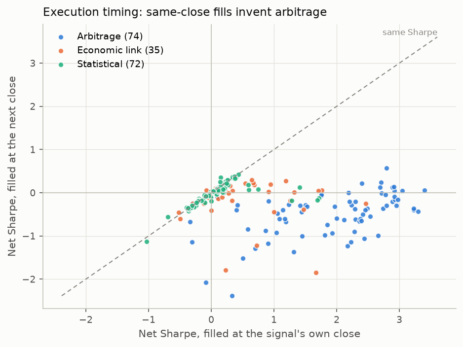
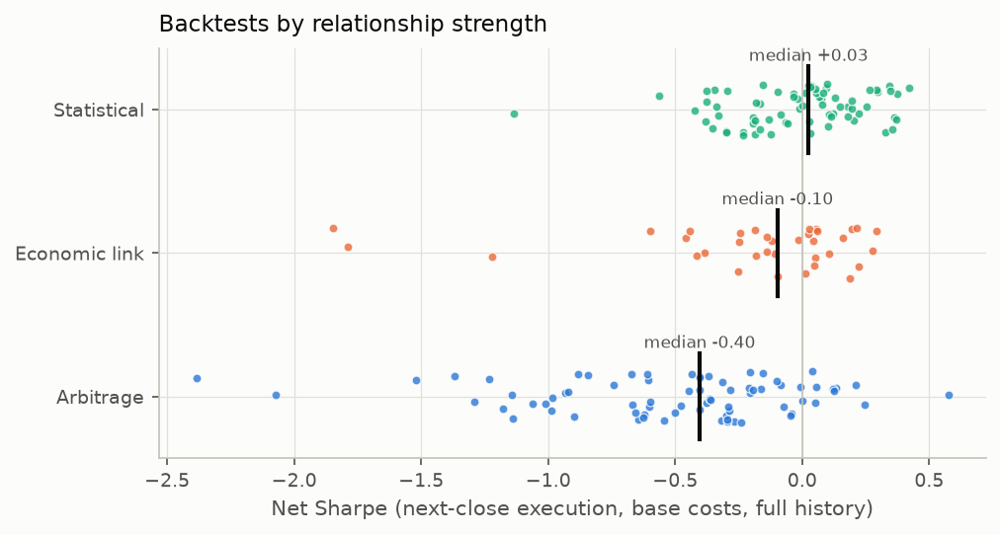
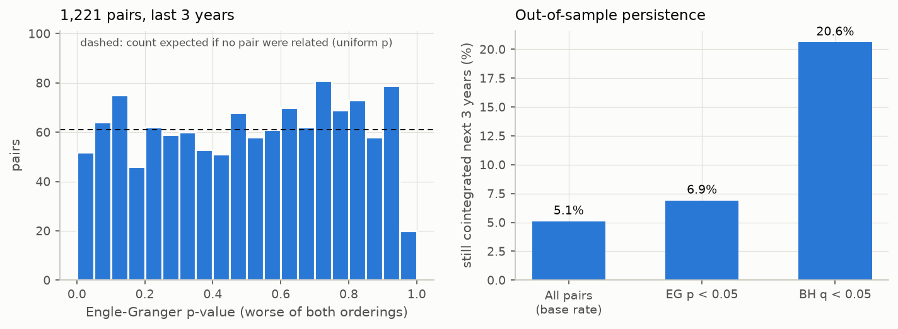
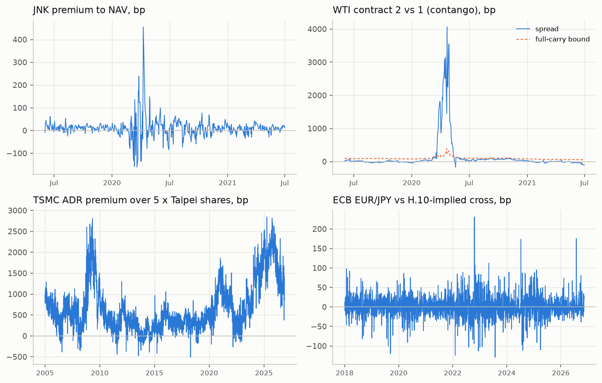
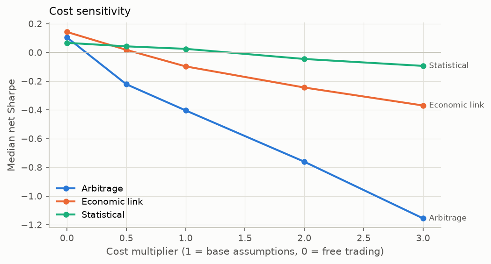

# Cross-asset relative value: what survives costs, timing and multiple testing

*Data to 2026-11-20. Generated by `scripts/build_report.py` from the files in `results/`; every number below is computed,
not typed. Parameters (entry |z| = 2, exit 0.5, stop 4, 126-period z window, next-close execution, base costs) were
fixed before any result was seen and are the same for every relationship.*

## Summary

- **191 relationships across 9 asset classes**, each labelled by what links the
  prices: 74 arbitrage relationships (a mechanism can force convergence),
  40 economic links (a reason to converge, nothing that forces it) and
  77 statistical relationships.
- **Timing is the whole game for daily-close arbitrage.** Filling at the very close that produced the signal gives
  73 relationships a net Sharpe above 1 (median 2.20
  for arbitrage relationships). Filling at the next close, which a real trader could do, leaves
  0 above 1 and a median of -0.40. The apparent edge is
  bid-ask bounce at the close, stale NAVs and closing prices taken hours apart.
- **Multiple testing removes what is left.** Of 181 strategies, 10 are positive at
  p < 0.05, against 9.1 expected by chance; 0 survive Benjamini-Hochberg at
  q < 0.10 and 0 survive Bonferroni. White's reality check gives the best strategy
  (CARRY_DKK) p = 0.27; its deflated Sharpe ratio is 0.000.
- **The cointegration scan finds what chance predicts.** 1221 pairs over the last three years:
  52 pass Engle-Granger at 5% (4.3%) when
  independent random walks pass 5.5% of the time; 1 survives
  Benjamini-Hochberg. Selected pairs stay cointegrated in the next three years more often than the base rate
  (20.6% after BH, 6.9% for raw p < 0.05,
  5.1% base), but traded out of sample with frozen hedges they lose money after
  costs (-5.4 and -18.3 bp per pair-year).
- **What does earn something is carry, a risk premium, not an arbitrage**: 92%
  of the 13 FX carry backtests are positive (median Sharpe
  0.29), the highest share of any opportunity type, yet none is
  individually significant after the corrections above.
- **Today's scan**: 0 executable arbitrage(s),
  1 executable economic link(s),
  11 statistical signals and 43 signals that fail at
  least one executability check.

The interactive scanner is at <https://rasmuscodes.github.io/projects/cross-asset-rv/>.

## 1. Data

| Asset class | Instruments | Earliest data | Licences |
|---|---|---|---|
| Equity indices | 11 | 1970-01-02 | vendor |
| Futures | 32 | 1980-01-02 | public-domain, vendor |
| Commodities (spot) | 5 | 1986-01-02 | public-domain |
| ETFs | 76 | 1993-01-29 | vendor |
| Equities, ADRs and dual listings | 152 | 1970-01-02 | vendor |
| FX | 39 | 1971-01-04 | open-attribution, public-domain |
| Sovereign bonds | 43 | 1974-09-24 | open-attribution, public-domain |
| Corporate bonds | 12 | 1953-04-01 | public-domain, vendor |
| Interest-rate and funding instruments | 26 | 1954-01-04 | open-attribution, public-domain |

Open sources are public domain (US Treasury, Federal Reserve, EIA) or reusable with attribution (New York Fed, ECB,
Bundesbank, Japan's Ministry of Finance, Bank of Canada, Reserve Bank of Australia, Bank of England, OECD). Vendor data
(Yahoo Finance prices, SSGA NAV histories, Moody's and ICE yields redistributed by FRED) is used for research but never
redistributed: the repository contains no raw data, and the public demo shows vendor-based relationships only as
derived analytics. Known gaps and traps, all handled in code:

- EIA stopped publishing NYMEX futures (contracts 1-4) on 2024-04-05, so calendar and crack spreads end there.
- Fed H.10 FX rates are published weekly; their latest days are filled with ECB reference rates (EUR crosses). The
  Taiwan dollar has no ECB rate, so TWD conversions stop at the last H.10 date.
- Yahoo's `range=max` request silently returns monthly bars; daily history needs explicit period bounds.
- WTI contract 1 settled at -37.63 on 2020-04-20: returns across non-positive prices are left undefined.
- Vendor total returns sometimes adjust a corporate action on one listing only; same-claim pairs drop days with a
  >15% one-day gap between the lines and report how many (for example Unilever's ADR history).

## 2. Universe and relationships

| Opportunity type | Arbitrage | Economic link | Statistical |
|---|---|---|---|
| ADR conversion parity | 36 | 9 | 0 |
| Bond spread dislocations | 0 | 0 | 26 |
| Calendar spreads | 0 | 6 | 0 |
| Carry and funding | 0 | 2 | 17 |
| Commodity term structures and spreads | 0 | 5 | 0 |
| Cross-listed securities (interlisted, dual-listed, share classes) | 13 | 9 | 0 |
| ETF vs underlying basket (NAV) | 18 | 0 | 0 |
| ETFs on the same index | 0 | 8 | 0 |
| Equity index relative value | 0 | 0 | 7 |
| FX-adjusted relative value | 3 | 1 | 6 |
| Futures basis | 4 | 0 | 0 |
| Sector and industry pairs | 0 | 0 | 21 |

Definitions: **arbitrage** = Arbitrage relationship: a contractual or creation/redemption mechanism can force convergence (net of costs). **Economic link** = Economic link: a convergence mechanism exists but cannot be forced on any timetable. **Statistical** = Statistical only: co-movement without a mechanism. Signals are bets, never arbitrage.

## 3. Methods

**Spreads.** Parity spreads are log price ratios in USD at the official conversion ratio (ADR ratio, share-class
conversion, 1:1 for interlisted shares); ETF premiums are measured against the issuer's NAV; the futures basis is the
log basis minus (financing - dividend yield) x time to expiry, with the quoted contract inferred from the basis;
calendar spreads use EIA contracts with exchange expiry rules and roll-adjusted returns; bond spreads are DV01-weighted
yield spreads; statistical pairs use hedge ratios re-estimated every day from data up to the day before.

**Models.** ADF and Engle-Granger tests with MacKinnon (1994, 2010) p-values, Johansen trace and maximum-eigenvalue
tests, Kalman-filter dynamic hedges, Ornstein-Uhlenbeck half-lives (with Dickey-Fuller rather than normal critical
values), a two-state Markov-switching AR(1) (Hamilton filter, Kim smoother, EM), Bayesian model comparison between
mean reversion and a random walk (conjugate Normal-Inverse-Gamma, closed-form marginal likelihoods) with
posterior-predictive forecasts, Bayesian online change-point detection, rolling stability and CUSUM tests. The
statistical code is tested against statsmodels and against simulations with known answers (`tests/`).

**Costs.** Stress-scaled half-spreads (multiplied by the ratio of 21-day to median volatility, capped at 4x),
commissions, square-root market impact for capacity, transaction taxes (UK stamp duty, Hong Kong stamp duty, Taiwan
securities transaction tax, Indian STT, Korean transaction tax, Swiss stamp duty, French FTT), FX conversion, ADR
conversion fees, funding spreads, borrow fees (with non-borrowable markets flagged) and a full re-trade at every
futures roll. Backtests are also run with all costs doubled.

**Validation.** In-sample to 2015, out-of-sample from 2016; Benjamini-Hochberg, Benjamini-Yekutieli, Holm and
Bonferroni corrections; random-walk null rates for the cointegration screen; deflated Sharpe ratio and White's reality
check (stationary bootstrap); rolling formation-to-test persistence; walk-forward regime and Bayesian gates.

## 4. Results

### 4.1 Backtests by strength and type



| Strength | Same-close fills | Next-close fills |
|---|---|---|
| Arbitrage | 2.20 | -0.40 |
| Economic link | 0.33 | -0.10 |
| Statistical | 0.10 | 0.03 |

| Strength | Strategies | Median net Sharpe | Share positive | Median gross Sharpe |
|---|---|---|---|---|
| Arbitrage | 74.00 | -0.40 | 0.12 | 0.14 |
| Economic link | 35.00 | -0.10 | 0.46 | 0.18 |
| Statistical | 72.00 | 0.03 | 0.53 | 0.07 |



| Type | Strategies | Median net Sharpe | Share positive | Median trades |
|---|---|---|---|---|
| ADR conversion parity | 45.00 | -0.29 | 0.36 | 224.00 |
| Bond spread dislocations | 25.00 | -0.17 | 0.32 | 52.00 |
| Calendar spreads | 6.00 | -0.19 | 0.17 | 94.00 |
| Carry and funding | 13.00 | 0.29 | 0.92 | 43.00 |
| Commodity term structures and spreads | 2.00 | -0.02 | 0.50 | 63.50 |
| Cross-listed securities (interlisted, dual-listed, share classes) | 22.00 | -0.23 | 0.32 | 223.00 |
| ETF vs underlying basket (NAV) | 18.00 | -0.57 | 0.00 | 194.00 |
| Futures basis | 4.00 | -0.06 | 0.00 | 171.50 |
| FX-adjusted relative value | 10.00 | -0.16 | 0.30 | 303.50 |
| Equity index relative value | 7.00 | -0.01 | 0.43 | 60.00 |
| ETFs on the same index | 8.00 | -0.40 | 0.00 | 117.00 |
| Sector and industry pairs | 21.00 | 0.03 | 0.57 | 49.00 |

The in-sample and out-of-sample Sharpe ratios have a rank correlation of 0.49; the median
out-of-sample Sharpe is -0.24. The ten best in-sample relationships, out of sample:

| Relationship | Sharpe to 2015 | Sharpe 2016 on |
|---|---|---|
| PAIR_GDX_GDXJ | 0.90 | -0.01 |
| CRACK_321 | 0.53 | -0.55 |
| CARRY_MXN | 0.46 | 0.37 |
| CARRY_KRW | 0.42 | -0.15 |
| ADR_TM | 0.41 | -0.33 |
| ADR_HMC | 0.41 | -0.49 |
| PAIR_IBB_XBI | 0.40 | 0.03 |
| CARRY_GBP | 0.39 | 0.40 |
| CARRY_CAD | 0.37 | 0.42 |
| CARRY_SEK | 0.37 | 0.46 |

### 4.2 Multiple testing

181 strategies with more than two years of data were tested for a positive mean (one-sided). Raw
p < 0.05: 10 (expected under the null: 9.1). Benjamini-Hochberg q < 0.05:
0; q < 0.10: 0; Bonferroni: 0. White's reality check on
174 daily strategies over 3916 days: p = 0.27 for the best (CARRY_DKK).
Its annualised Sharpe of 0.72 compares with an expected maximum of 1.96 from
543 trials with no skill, so the deflated Sharpe ratio is 0.0000.

### 4.3 The cointegration scan



Groups: equity ETFs, bond ETFs, commodity ETFs, single stocks, 10-year sovereign yields and G10 FX. Each pair is
tested both ways and must pass in the worse ordering; 127 pairs would pass if either ordering
were enough. Johansen's trace test finds rank >= 1 for 107 pairs (uncorrected). Rolling
three-year formation windows from 2008 to 2022, then the next three years for persistence and the next year for frozen-hedge
trading:

| Selection | pair_years | mean_net | median_net | share_positive | mean_gross | mean_trades |
|---|---|---|---|---|---|---|
| bh_q05 | 43.00 | -5.42 | 0.00 | 0.23 | 39.50 | 2.56 |
| random_all | 2226.00 | -66.86 | 0.00 | 0.35 | -25.13 | 1.91 |
| raw_p05 | 809.00 | -18.26 | 0.00 | 0.41 | 33.64 | 2.84 |

### 4.4 Hedge ratios

| Method | Median net Sharpe | Share positive |
|---|---|---|
| kalman | 0.00 | 0.54 |
| ratio | 0.00 | 0.50 |
| rolling | 0.00 | 0.54 |
| static | -0.03 | 0.29 |

Static hedges estimated on the first three years and frozen decay; the dynamic estimators are indistinguishable once
costs are paid. Best method by pair: kalman 11, ratio 7, static 7, rolling 3.

### 4.5 Regime and Bayesian gates

Across 88 economic-link and statistical relationships with at least six years of daily data, a walk-forward
Markov-switching filter (refit yearly on three years, gate open when the mean-reverting state has probability >= 0.5)
changed the median Sharpe by 0.02 and improved 56% of
relationships; the Bayesian gate (refit monthly on two years, open when P(mean reversion) >= 0.9) changed it by
0.02 and improved 56%. Median Sharpe: no gate
-0.10, regime gate -0.05, Bayesian gate
-0.05: a little less negative, mostly because the gates keep the book out of the market.

### 4.6 Today's scan

| Strength | executable (not enforceable) | monitor | no signal | statistical signal | watch |
|---|---|---|---|---|---|
| Arbitrage | 0 | 0 | 53 | 0 | 21 |
| Economic link | 1 | 5 | 26 | 0 | 8 |
| Statistical | 0 | 5 | 47 | 11 | 14 |

Signals that pass every check:

| Relationship | Strength | Verdict | z | Deviation | Half-life | Cost r/t | Net edge |
|---|---|---|---|---|---|---|---|
| GLD vs IAU | Economic link | executable (not enforceable) | -3.87 | -7.05 | 9.00 | 6.16 | 1.62 |
| GS vs MS | Statistical | statistical signal | -3.73 | -609.57 | 15.90 | 10.14 | 456.59 |
| US 2s10s curve | Statistical | statistical signal | -2.81 | -19.41 | 23.88 | 1.00 | 14.60 |
| 10y breakeven inflation | Statistical | statistical signal | -2.56 | -16.35 | 15.46 | 2.50 | 7.55 |
| Long EUR vs USD carry | Statistical | statistical signal | -1.21 | -15.54 | – | 2.00 | 45.81 |
| Long JPY vs USD carry | Statistical | statistical signal | 3.62 | 30.79 | – | 2.00 | 54.47 |
| Long CHF vs USD carry | Statistical | statistical signal | -1.22 | -14.85 | – | 2.00 | 97.54 |
| Long CAD vs USD carry | Statistical | statistical signal | -1.11 | -7.86 | 49.74 | 2.00 | 38.30 |
| Long SEK vs USD carry | Statistical | statistical signal | -1.40 | -14.13 | – | 2.00 | 47.95 |
| Long DKK vs USD carry | Statistical | statistical signal | 5.92 | 25.35 | – | 2.00 | 32.25 |
| Long MXN vs USD carry | Statistical | statistical signal | -6.79 | -54.75 | – | 16.00 | 55.75 |
| Long ZAR vs USD carry | Statistical | statistical signal | -0.85 | -12.81 | – | 16.00 | 56.75 |

Why the other signals are not executable:

| Reason a signal is not executable | Signals |
|---|---|
| half-life under one period | 19 |
| expected convergence does not cover costs | 15 |
| no evidence of mean reversion in the trailing window | 14 |
| closing prices 4.5 h apart | 10 |
| closing prices 4.0 h apart | 7 |
| closing prices 12.8 h apart | 4 |
| closing prices 14.5 h apart | 3 |
| closing prices 5.0 h apart | 2 |
| data end 2024-04-05 | 1 |
| closing prices 15.5 h apart | 1 |
| closing prices 11.0 h apart | 1 |
| short leg not borrowable | 1 |
| direction blocked by conversion / borrow limits | 1 |
| closing prices 15.0 h apart | 1 |
| data end 2026-10-31 | 1 |

## 5. Failed opportunities and false positives



**FX triangle from two official fixings.** The ECB's EUR/JPY fixing (14:15 Frankfurt) against the cross implied by the
Fed's noon New York rates looks like a mean-reverting arbitrage spread:

| Cross | Same-close Sharpe | Next-close Sharpe | Spread s.d. (bp) | Half-life (days) |
|---|---|---|---|---|
| TRI_EURJPY | 3.30 | -0.43 | 37.01 | – |
| TRI_EURGBP | 3.23 | -0.36 | 26.07 | – |
| TRI_EURCHF | 2.97 | -0.15 | 19.84 | 0.24 |

It is the market move between two fixings six hours apart, untradable at both prices.

**ADR premiums across time zones.** Today's premium predicts tomorrow's home-market return (median correlation
0.55 for Asian listings, 0.27 for
European ones): the home market catches up with the New York move overnight. Across 45 ADRs the
median Sharpe falls from 2.17 with same-close fills to
-0.29 with next-close fills.

**Stale NAVs.** International funds' NAVs are struck at foreign closes, so their "premium" predicts the next NAV change:

| Fund type | corr(premium, next NAV change) | Premium s.d. (bp) | Same-close Sharpe | Next-close Sharpe |
|---|---|---|---|---|
| bond | 0.04 | 31.29 | -0.30 | -0.91 |
| bond_intl | 0.19 | 46.49 | 0.12 | -2.23 |
| commodity | 0.60 | 68.83 | 3.22 | -0.40 |
| equity | 0.01 | 12.91 | 1.20 | -0.53 |
| equity_intl | 0.37 | 74.82 | 2.78 | -0.09 |

**Futures basis from daily closes.** The measured mispricing moves far more from day to day than any plausible
financing anomaly:

| Future | Mispricing s.d. (bp) | Daily change s.d. (bp) | Half-life (days) | Same-close Sharpe | Next-close Sharpe |
|---|---|---|---|---|---|
| BASIS_ES1 | 16.29 | 22.38 | 0.24 | 1.75 | -0.07 |
| BASIS_NQ1 | 19.57 | 26.49 | 0.28 | 2.19 | -0.00 |
| BASIS_RTY1 | 21.57 | 30.11 | 0.19 | 1.42 | -0.30 |
| BASIS_YM1 | 16.92 | 21.73 | 0.40 | 1.75 | -0.05 |

**Premia that never converge.** Restricted ADR creation (Taiwan) and foreign-ownership limits (India) produce
persistent premia; a dual-listed company's two lines trade at a lasting gap:

- **ADR_TSM**: median premium 251 bp in 2015, 1379 bp in 2026; positive on 96% of days.
- **ADR_INFY**: median premium 136 bp in 2015, 31 bp in 2026; positive on 72% of days.
- **ADR_HDB**: median premium 1616 bp in 2015, 221 bp in 2026; positive on 88% of days.
- **ADR_IBN**: median premium 374 bp in 2015, -45 bp in 2026; positive on 63% of days.
- **DLC_RIO_L_RIO_AX**: median premium -96 bp in 2015, -2072 bp in 2026; positive on 37% of days.

**A no-arbitrage bound that failed.** In 2020-04 the WTI contract-2 vs contract-1 spread reached
4064 bp against a full-carry bound of 286 bp: the bound assumes
storage is available, and Cushing was full. Contango exceeded the assumed full-carry bound on
1833 days since 2000.

**Berkshire's conversion bound.** Class A converts into 1,500 class B, so B should not trade above A/1500 by more than
costs. At daily closes it did on 23.6% of days (minimum
-192 bp on 2020-03-13), all closing-print noise: same-close Sharpe
0.91, next-close -0.19.

**Interlisted Canadians.** The same share in Toronto and New York, both closing at 16:00, converted at the noon CAD
fixing: median Sharpe 2.33 same-close, -0.62
next-close across 12 names.

## 6. Costs, capacity and stability



| Strength | 0.0 | 0.5 | 1.0 | 2.0 | 3.0 |
|---|---|---|---|---|---|
| Arbitrage | 0.10 | -0.22 | -0.40 | -0.76 | -1.16 |
| Economic link | 0.14 | 0.02 | -0.10 | -0.24 | -0.37 |
| Statistical | 0.07 | 0.04 | 0.03 | -0.04 | -0.09 |

Square-root impact for the relationships with the best base Sharpe, against their average gross P&L per trade:

| Relationship | Gross per trade (bp) | Impact r/t at $1m (bp) | Impact r/t at $10m (bp) | Impact r/t at $100m (bp) |
|---|---|---|---|---|
| ADR_ZTO | 112.5 | 94.2 | 297.9 | 942.2 |
| CARRY_CAD | 97.5 | 0.0 | 0.0 | 0.0 |
| CARRY_DKK | 97.9 | 0.0 | 0.0 | 0.0 |
| CARRY_EUR | 54.4 | 0.0 | 0.0 | 0.0 |
| CARRY_GBP | 185.4 | 0.0 | 0.0 | 0.0 |
| CARRY_KRW | 322.1 | 0.0 | 0.0 | 0.0 |
| CARRY_MXN | 944.1 | 0.0 | 0.0 | 0.0 |
| CARRY_SEK | 208.7 | 0.0 | 0.0 | 0.0 |
| CLASS_UAA_UA | 97.7 | 250.1 | 791.0 | 2501.2 |
| IDX_DIA_SPY | 66.5 | 3.1 | 9.7 | 30.8 |
| PAIR_GDX_GDXJ | 131.8 | 36.7 | 116.0 | 366.7 |
| PAIR_T_VZ | 148.6 | 13.4 | 42.4 | 134.1 |

Stability (rolling two-year windows, stepped every six months):

| Strength | Relationships | Windows stationary (median) | Median half-life (days) | Half-life IQR ratio |
|---|---|---|---|---|
| Arbitrage | 74.00 | 1.00 | 0.30 | 1.52 |
| Economic link | 35.00 | 0.31 | 8.01 | 1.89 |
| Statistical | 53.00 | 0.09 | 13.60 | 1.36 |

## 7. Limitations

- Daily closing data only. Intraday synchronised quotes would turn several "timing artefact" verdicts into measured
  executable spreads (or confirm there are none); they are not freely available.
- Corporate bonds are covered by indices (Moody's, Treasury HQM, ICE OAS) and ETFs, not issuer-level bonds (TRACE).
- No FX forwards, so covered-interest-parity bases cannot be measured; carry uses lagged OECD 3-month rates.
- Index futures use Yahoo's continuous front contract, whose month is inferred; expired individual contracts are not
  available.
- Borrow availability and fees are tier assumptions, not locate data.

## 8. Reproduce

```
python -m venv .venv && .venv\Scripts\pip install -e .[dev]
python scripts/fetch_data.py          # ~15 min; cached under data/raw with a provenance manifest
python scripts/run_research.py        # experiments E1-E9 -> results/
python scripts/build_report.py        # this report
python scripts/build_demo.py          # demo/data for the web demo
pytest
```
